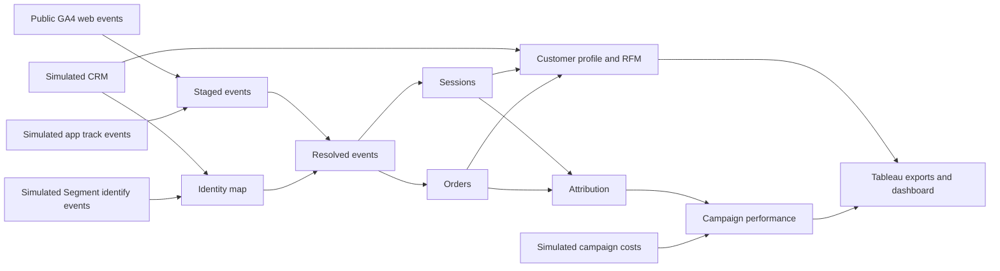

# Architecture and data contract

| Table | Grain | Important fields |
|---|---|---|
| crm | One synthetic CRM customer | customer_id, market |
| identify | One assertion per anonymous ID and CRM ID | anonymous_id, customer_id |
| app_events | One simulated app event | anonymous_id, session_id, ts, event_name, order_id, revenue, channel, campaign |
| spend | One cost input per date and campaign | spend_date, channel, campaign, cost_usd |
| identity_map | One row per asserted anonymous ID | customer_id, identity_status |
| sessions | One row per namespaced session | session_id, customer_key, session_ts, events, channel, campaign |
| orders | One row per transaction ID | order_id, customer_key, order_ts, revenue |
| customer_profile | One row per CRM or anonymous customer key | frequency, recency_days, monetary, RFM scores, segment, observed_ltv, annualized_ltv_proxy |
| attribution | One row per credited order, touch and model | order_id, session_id, model, channel, campaign, weight, credited_revenue |
| campaign_performance | One row per model, channel and campaign | credited_revenue, credited_orders, credited_new_customers, spend, roas, roi, cpa |

Time is stored in epoch seconds. Monetary values are USD. The sample covers 1 November 2020 to 31 January 2021. GA4 traffic parameters are event-scoped. The session takes the earliest classified event and defaults to Direct when all classifications are absent. The extract excludes placeholder users. Purchase duplicates resolve to the earliest retained event.

The generated Segment Identify contract is equivalent to an `identify` payload with `anonymousId` and `userId`. Python simulates it and app Track events. A live Segment implementation would map its source-specific device ID to the namespaced anonymous ID and populate the input tables. The demo assumes one stable CRM identity per device for the whole window and applies an unambiguous identity to earlier activity. Conflicts retain the anonymous key. For production, retain assertion timestamps, handle shared devices, and measure match coverage using verified joins. [Segment identity documentation](https://segment.com/blog/instrumenting-user-insights-for-your-ai-copilot/)

The warehouse generator uses a deterministic sample of GA4 purchaser aliases to model CRM coverage. The public GA4 IDs are obfuscated and exported reports contain aggregates. No real person or CRM record is inferred.

The offline runner inserts data in the staged-event shape and executes the shared downstream dbt SQL with SQLite. This verifies model behavior on the fixture. The warehouse adapter, GA4 event extraction and cloud setup require a BigQuery run.
